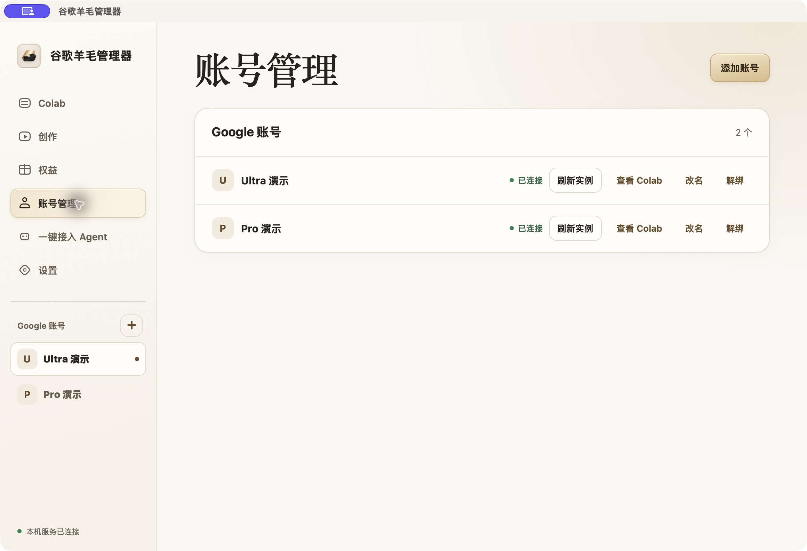
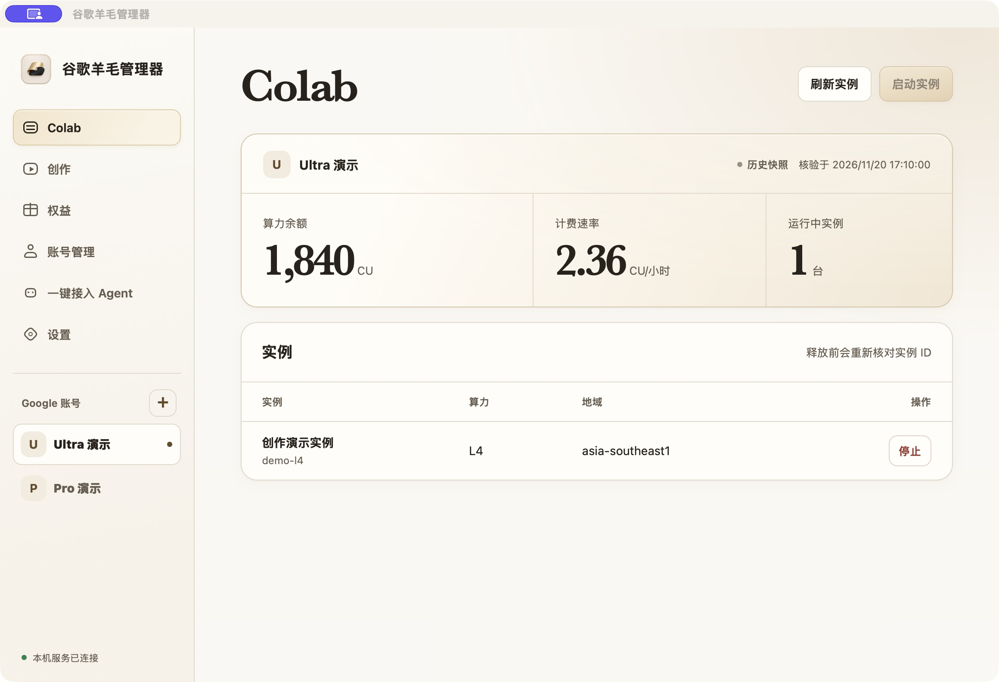
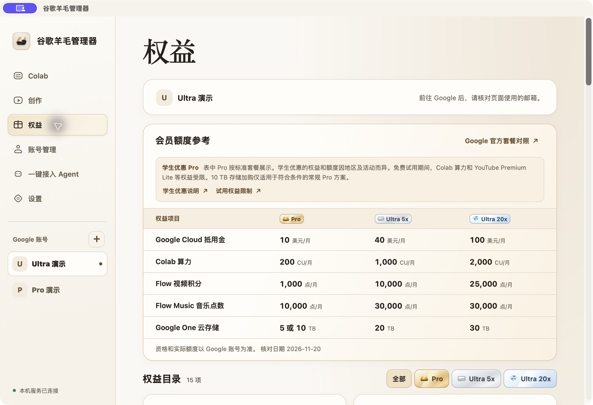
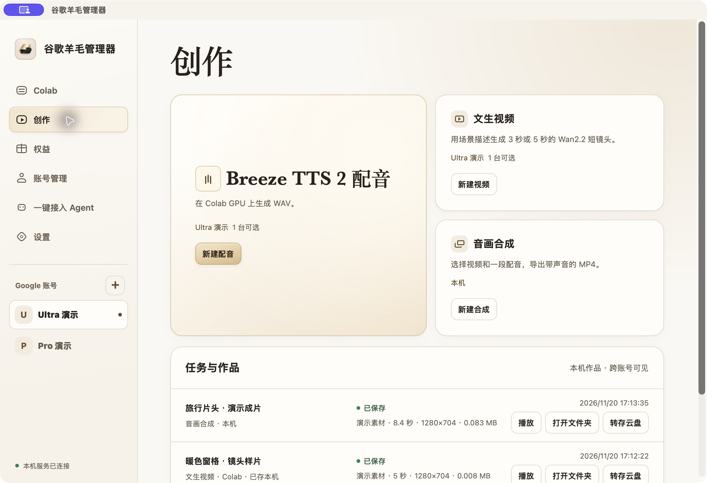
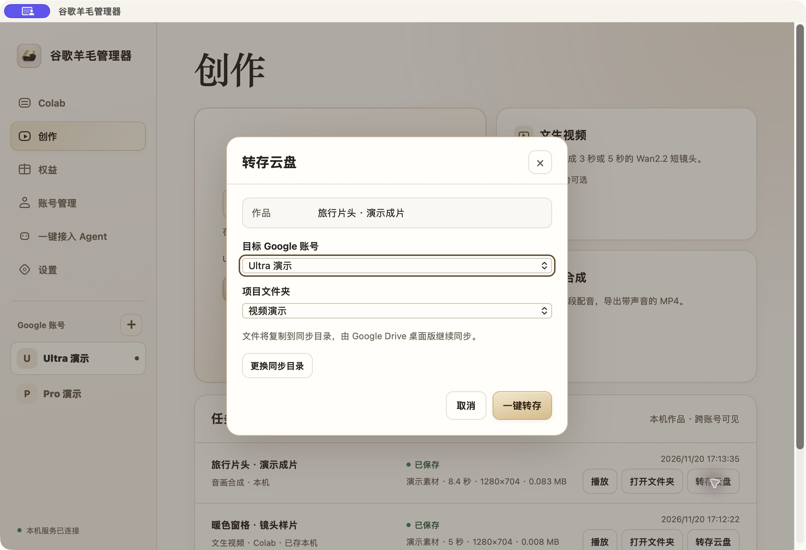
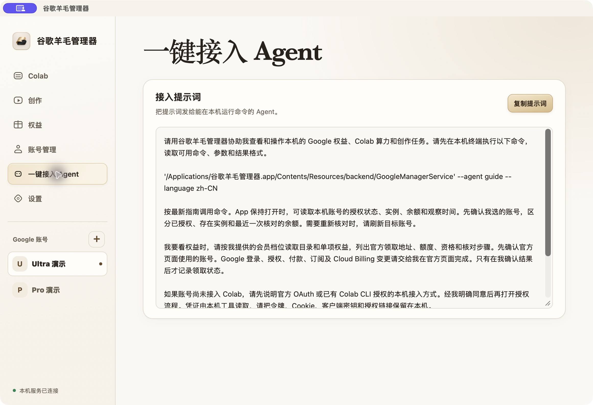

# Google Perks Manager

[简体中文](README.md) · [GitHub Releases](https://github.com/HeiGeAi/google-perks-manager/releases/latest)

An independent desktop app for Google plan perks, per-account Colab instances and compute units, cloud voice and video jobs, and local output files.

## App screenshots and walkthrough

These are **real screenshots of the released v0.9.0 app running on an Apple silicon Mac**. The accounts, compute usage, and output files are demo data.

https://github.com/user-attachments/assets/be1f0ab7-5251-4b4b-8776-283110dc13d9

[Download the original MP4 (35 seconds, Chinese captions)](https://github.com/HeiGeAi/google-perks-manager/releases/download/v0.9.0/GooglePerksManager-demo.mp4)

| Google accounts | Colab instances and compute |
| --- | --- |
| [](docs/media/v0.9.0/accounts.jpg) | [](docs/media/v0.9.0/colab.jpg) |
| Name accounts, check their connection status, and switch between them. | See compute balance, usage rate, and GPU instances for the selected account. |

| Pro and Ultra perks | Studio and local outputs |
| --- | --- |
| [](docs/media/v0.9.0/perks.jpg) | [](docs/media/v0.9.0/studio.jpg) |
| Compare plan allowances and student offers, and open official claim and verification pages. | Make voiceovers and clips on Colab. Play or reveal outputs saved on this computer from any account. |

| Save to Drive by project | Connect an agent |
| --- | --- |
| [](docs/media/v0.9.0/drive.jpg) | [](docs/media/v0.9.0/agent.jpg) |
| Select an account and project, then copy an output to its Google Drive sync folder. | Copy the connection prompt for an agent with terminal access on the same computer. |

## WeChat community

| Scan to join the group | Scan to add Heige on WeChat |
| --- | --- |
|  |  |
| Valid before November 27, 2026 | Include **谷歌交流群** in your friend request |

## Install

| System | Install |
| --- | --- |
| macOS 14 or newer, Apple silicon | Download `GooglePerksManager-macOS-arm64.zip`, extract it, and move `谷歌羊毛管理器.app` to Applications. |
| Windows x64, build 19041 or later | Run `GooglePerksManager-Windows-x64-Setup.exe`. Setup installs Microsoft Edge WebView2 when needed. |

macOS can show a developer verification notice when you first open an app downloaded from GitHub. The project signs its release manifest. Check the release page for the SHA-256 of the Windows installer. [Apple’s first-launch guidance](https://support.apple.com/en-us/102445)

The app follows the system language by default. Use **Settings → Language** to pick English, Simplified Chinese, or the system language. Use **Check for updates**, **Download update**, and **Install update** to apply releases. The app verifies the signed release manifest and installer before opening the installation flow.

## Main views

| View | What you can do |
| --- | --- |
| Accounts | Select Connect to Google to open Google’s consent page. Paste the code Google shows after approving the official Colab CLI connection. Under Other ways to connect, you can import an existing Colab CLI grant or use a desktop OAuth client for automatic callback. |
| Colab | Check compute units, hourly usage, and running instances. Choose the account and runtime before starting or stopping an instance. |
| Perks | Compare Google AI Pro, Ultra 5x and Ultra 20x, check student and trial restrictions, and record results for each account. |
| Studio | Run Breeze TTS 2 or Wan2.2 on a selected Colab GPU. Play, reveal, or remix outputs saved on this computer from any account. |

Google determines actual benefit eligibility, Colab availability, and usage. The Breeze TTS 2 weights and self-hosted outputs carry research and non-commercial terms. [Google AI plans](https://one.google.com/intl/en/about/google-ai-plans/?gl=US&hl=en) · [Developer Program perks](https://developers.google.com/profile/help/benefits?hl=en) · [Colab FAQ](https://research.google.com/colaboratory/faq.html) · [Breeze TTS 2](https://huggingface.co/BreezeBlue/Breeze-TTS-2)

## Save outputs to Google Drive

Choose **Save to Drive** on an output in Studio. Sign in to the destination account in Google Drive for desktop and select its My Drive or sync folder once. Choose an existing project or name a new one, then select **Save to Drive**. The app copies the output into a project folder under **Google Perks Manager** and keeps the original on your computer. Repeating the same transfer reuses the verified copy. Check upload progress in Google Drive for desktop. [Google Drive for desktop](https://support.google.com/drive/answer/10838124?hl=en)

## Connect an agent

Choose **Connect an Agent** in the sidebar and copy the prompt into an agent with a terminal on the same computer. The prompt includes the executable path. The local interface can read the perk catalog and official claim steps, report the current account and Colab status, start the Google authorization flow, and work with jobs and output files.

```bash
app_agent="/Applications/谷歌羊毛管理器.app/Contents/Resources/backend/GoogleManagerService"
"$app_agent" --agent guide --language en
"$app_agent" --agent state
"$app_agent" --agent benefits --plan pro
```

On Windows, the default installation supports PowerShell commands.

```powershell
$appAgent = Join-Path $env:LOCALAPPDATA 'Programs\GooglePerksManager\backend\GoogleManagerService.exe'
& $appAgent --agent guide --language en
& $appAgent --agent state
```

Google account consent and perk redemption are completed on Google’s own pages. The agent can guide that process and record the verified result in the app. Commands that change accounts or may spend compute units require explicit user confirmation. The agent can also combine existing files, check jobs, and retrieve outputs.

## Build

Install Apple’s Command Line Tools and `uv` on an Apple silicon Mac.

```bash
python3 -B -m unittest discover -s tests
./macos/build.sh
```

On Windows, install Python 3.13, the .NET 10 SDK, PowerShell 7, and Inno Setup 6.

```powershell
python -m pip install -r windows/requirements.txt
python -B -m unittest discover -s tests
./windows/build.ps1
```

Builds go under `dist`. Account authorizations and outputs are stored in `~/Library/Application Support/谷歌管理器` on macOS and `%LOCALAPPDATA%\HeiGeAi\GooglePerksManager` on Windows. Set `GOOGLE_MANAGER_DATA_DIR` to a private user directory to test with separate data.

The original app source is available under the [MIT license](LICENSE). Branding, dependencies, and model weights retain their respective licenses. Distributed builds contain dependency notices in `Notices`.
